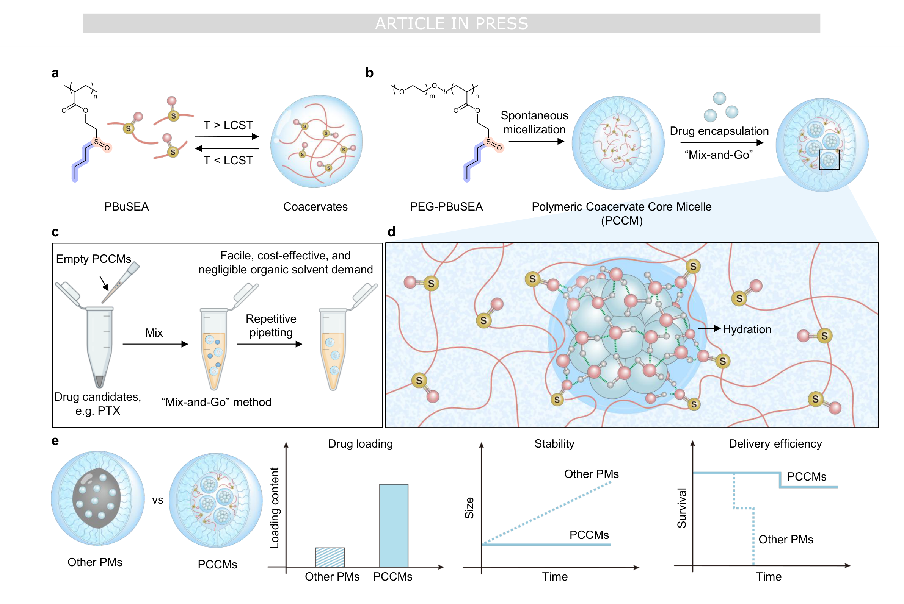

# Conventional methods for reading materials science

> 中文备注：**材料文献常规分析方法**  
> A reusable, prompt-driven workflow for reading materials-science papers: from research story to material design, synthesis logic, characterization rationale, mechanism, transferable methodology, and limitations.



## Why this repository exists

Materials-science papers are often hard to read because they mix **chemistry, physics, engineering, characterization, mechanism, and application**. This repository turns that complexity into a repeatable reading workflow.

It is built from a close reading of:

> Wang, J., Ying, J., Huang, J. *et al.* **Bridging hydrogen-bond-stabilized polymeric coacervate core micelles for high-efficiency drug encapsulation and delivery.** *Nature Communications* (2026).  
> DOI: [10.1038/s41467-026-72978-5](https://doi.org/10.1038/s41467-026-72978-5)

The example paper describes **PEG-PBuSEA polymeric coacervate core micelles, abbreviated PCCMs**, which use sulfoxide groups and bridging hydrogen bonds to stabilize amorphous drug nanoaggregates and achieve unusually high drug loading.

## Core idea

Do not read a materials paper as a list of experiments. Read it as a chain:

```text
Problem
  → target material state
  → chemical design
  → synthesis logic
  → physical properties
  → characterization evidence
  → mechanism
  → application
  → limitations
  → transferable methodology
```

For the example paper, the logic is:

```text
Poorly soluble drugs
  → conventional hydrophobic micelle cores load drugs poorly
  → need a hydrated, liquid-like, polar, hydrogen-bond-accepting core
  → PBuSEA forms LCST-type liquid coacervates
  → PEGylation turns large coacervate droplets into stable nanoscale micelles
  → sulfoxide-water-drug bridging hydrogen bonds stabilize drug nanoaggregates
  → high loading, simple Mix-and-Go preparation, improved in vivo delivery
```

## Repository structure

```text
.
├── README.md
├── prompts/
│   └── prompt-bank.md
├── methods/
│   └── materials-literature-analysis-workflow.md
├── case-study/
│   └── pccm-paper-analysis.md
├── figures/
│   ├── README.md
│   ├── figure-01-overview.png
│   ├── figure-02-coacervation.png
│   ├── figure-03-pccm-formation.png
│   ├── figure-04-loading-performance.png
│   ├── figure-05-drug-aggregates.png
│   ├── figure-06-structure-property.png
│   ├── figure-07-bridging-hydrogen-bonds.png
│   └── figure-08-in-vivo.png
├── NOTICE.md
└── LICENSE
```

## Reading workflow

### 1. Define the real bottleneck

Ask:

- What technical or clinical problem is the paper trying to solve?
- Why do existing materials fail?
- Which property is the true limiting variable?
- Is the bottleneck compatibility, kinetics, stability, toxicity, manufacturability, or delivery?

### 2. Translate the desired property into a material state

Ask:

- What state should the guest molecule be in?
- Molecularly dissolved, amorphous aggregate, crystalline, adsorbed, covalently conjugated, or phase-separated?
- What local microenvironment does that require?
- High polarity, low viscosity, hydration, charge, hydrogen bonding, confinement, or compatibility?

### 3. Identify the chemical design logic

Ask:

- Which functional group carries the key interaction?
- Why this backbone?
- Why this side chain?
- Why this oxidation state?
- Why this block architecture?
- Why this molecular weight or PEG length?

### 4. Map characterization to hypotheses

Ask:

- What does each measurement actually prove?
- What competing explanation does it exclude?
- If the experiment were removed, would the mechanism still be supported?

### 5. Extract transferable rules

Ask:

- Can this design rule be moved to another material system?
- Is the key concept hydrophobicity, hydration, interfacial stabilization, phase separation, confinement, or hydrogen bonding?
- How would I redesign the material for a new guest or application?

## Figure index

| Figure | File | Main question |
|---|---|---|
| Fig. 1 | [figure-01-overview.png](figures/figure-01-overview.png) | What is the overall PCCM concept? |
| Fig. 2 | [figure-02-coacervation.png](figures/figure-02-coacervation.png) | Does PBuSEA form liquid coacervates? |
| Fig. 3 | [figure-03-pccm-formation.png](figures/figure-03-pccm-formation.png) | Does PEGylation preserve the coacervate core? |
| Fig. 4 | [figure-04-loading-performance.png](figures/figure-04-loading-performance.png) | Does the material actually load drugs efficiently? |
| Fig. 5 | [figure-05-drug-aggregates.png](figures/figure-05-drug-aggregates.png) | Are drugs molecularly dispersed or nanoaggregated? |
| Fig. 6 | [figure-06-structure-property.png](figures/figure-06-structure-property.png) | Which drug structures load best? |
| Fig. 7 | [figure-07-bridging-hydrogen-bonds.png](figures/figure-07-bridging-hydrogen-bonds.png) | What is the loading mechanism? |
| Fig. 8 | [figure-08-in-vivo.png](figures/figure-08-in-vivo.png) | Does high loading improve therapy? |

Detailed figure interpretation is in [`case-study/pccm-paper-analysis.md`](case-study/pccm-paper-analysis.md).

## Reusable prompt bank

See [`prompts/prompt-bank.md`](prompts/prompt-bank.md). It includes prompt templates for:

- whole-paper deep reading;
- research-story extraction;
- materials-design logic;
- synthesis and characterization rationale;
- mechanism and contradiction analysis;
- figure-by-figure explanation;
- transferable methodology;
- new-material development;
- limitations and review-style critique.

## General methodology guide

See [`methods/materials-literature-analysis-workflow.md`](methods/materials-literature-analysis-workflow.md). It explains:

- how to infer why a material was chosen;
- how to connect monomers, functional groups, and properties;
- why each characterization experiment is used;
- how to build a mechanism evidence chain;
- how to migrate the logic to new systems;
- how to develop a new material systematically.

## Licensing and attribution

- Original summary, prompts, workflow, and analysis text in this repository: MIT License.
- Figure images remain under the original article license, **CC BY-NC-ND 4.0**, and are included as unmodified page images with attribution.
- The original PDF is not redistributed here.
- See [`NOTICE.md`](NOTICE.md).
