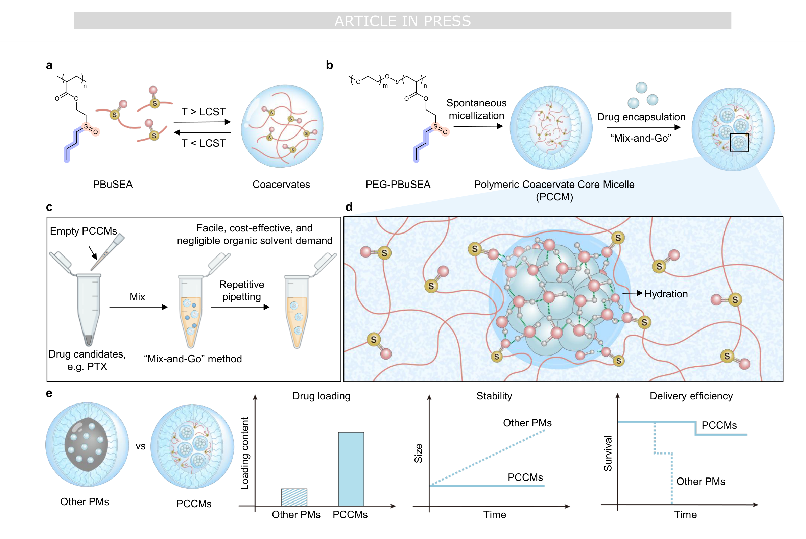
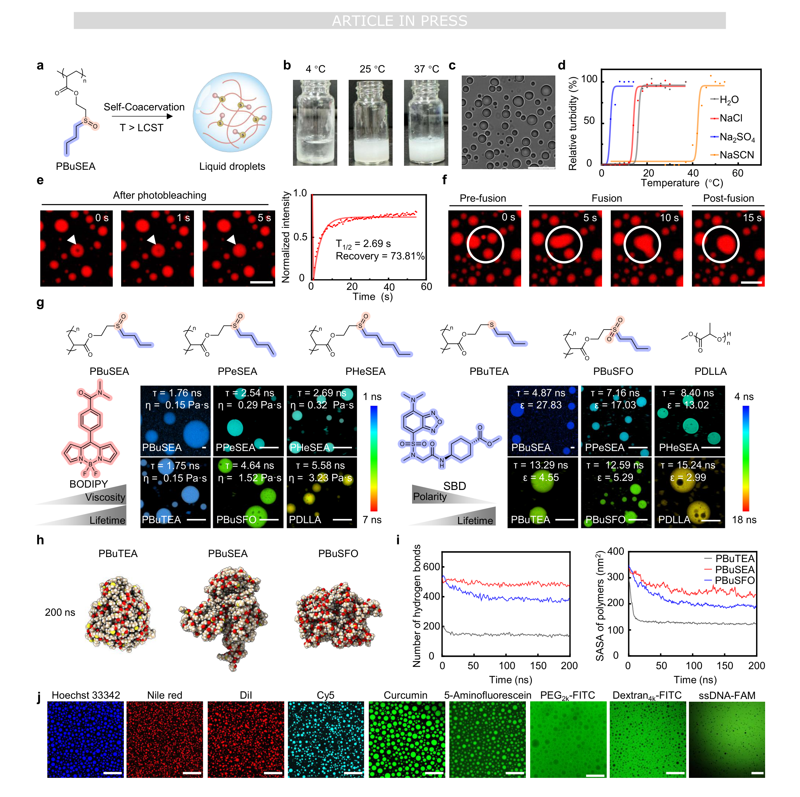
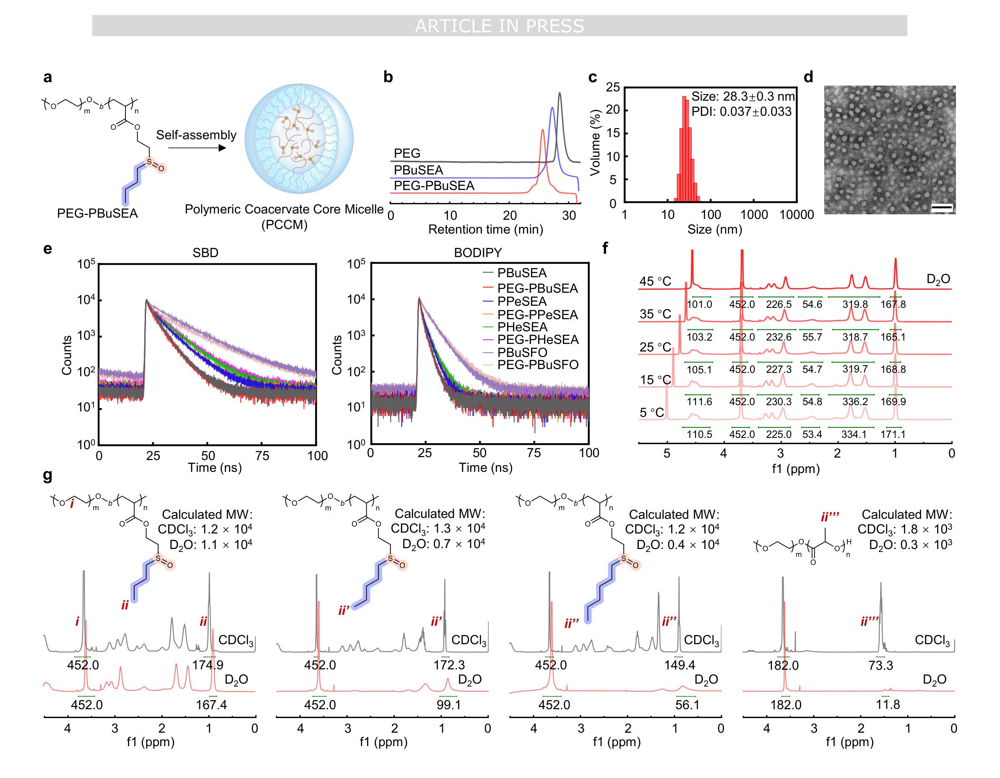
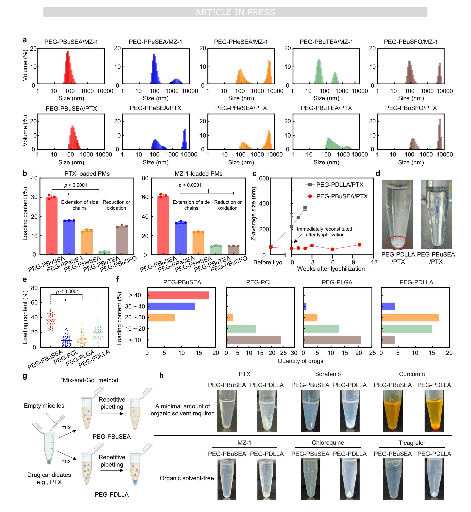
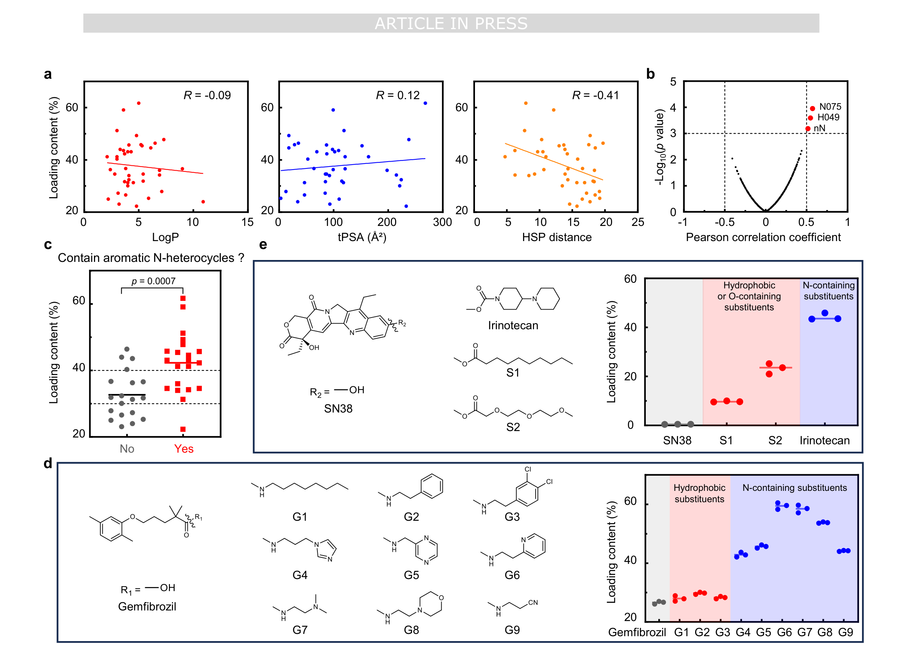
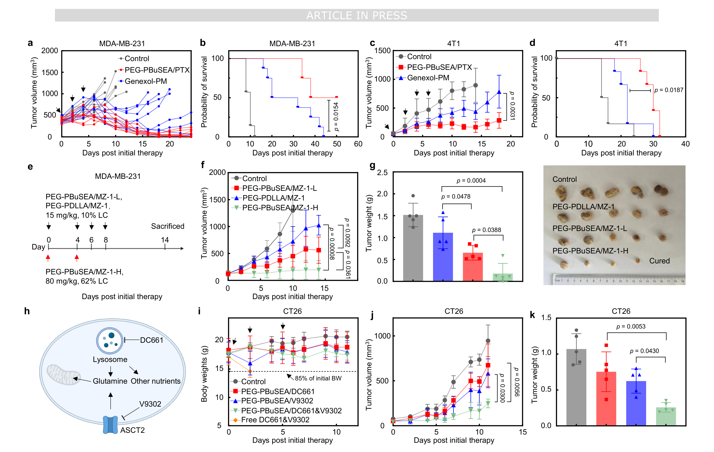

# Case study: bridging hydrogen-bond-stabilized PCCMs

Source paper:

> Wang, J., Ying, J., Huang, J. *et al.* **Bridging hydrogen-bond-stabilized polymeric coacervate core micelles for high-efficiency drug encapsulation and delivery.** *Nature Communications* (2026). DOI: [10.1038/s41467-026-72978-5](https://doi.org/10.1038/s41467-026-72978-5)

This case study summarizes the reading logic and interprets the eight main figures. The images are unmodified page images from the article.

---

## 1. One-sentence summary

The authors build PEG-PBuSEA polymeric coacervate core micelles, abbreviated PCCMs, whose hydrated sulfoxide-rich liquid cores use bridging hydrogen bonds to stabilize amorphous drug nanoaggregates, enabling broad, high-efficiency drug loading and improved in vivo delivery.

---

## 2. Problem and bottleneck

Many drugs are poorly water-soluble. Conventional polymer micelles try to solve this by placing drugs into a hydrophobic core. However, this often fails because:

- the hydrophobic core is compact and low-polarity;
- many drugs are structurally diverse and incompatible with the same core;
- drugs crystallize or form large precipitates;
- loading content is often below 10%;
- preparation often requires organic solvents, evaporation, or dialysis;
- micelles may aggregate during storage, lyophilization, or blood dilution.

Thus the real bottleneck is not merely “add more hydrophobic polymer.” The bottleneck is designing a core whose microenvironment is compatible with many drug structures while remaining nanoscale and stable.

---

## 3. Target material state

The authors do not simply ask the drug to dissolve molecule-by-molecule. Instead, they stabilize a different state:

```text
amorphous drug nanoaggregate
+ hydrated sulfoxide-rich interface
+ PEG-stabilized nanoparticle shell
```

This is important. A controlled aggregate can be useful if its surface is hydrated and prevented from growing into crystals or precipitates.

---

## 4. Core chemical insight

The key functional unit is the sulfoxide group:

```text
S=O
```

It acts like a polymerized version of a DMSO-like solvation motif:

- high polarity;
- strong hydrogen-bond acceptor;
- capable of binding water;
- able to form water-bridged hydrogen bonds to drug surface groups;
- able to keep drug aggregates hydrated and amorphous.

The final mechanism can be simplified as:

```text
polymer S=O
  ↔ water
  ↔ drug aggregate surface, especially N-containing acceptors
```

---

## 5. Figure-by-figure interpretation

## Fig. 1 — Overall PCCM concept



### Purpose

This figure introduces the full concept.

### Key message

PBuSEA forms liquid coacervate droplets above its LCST. PEGylation converts these droplets into stable nanoscale PCCMs. Drug loading can be performed by a simple Mix-and-Go process.

### Why it matters

It shows the conceptual shift:

```text
ordinary hydrophobic micelle core
  → liquid coacervate core
```

### Logical role

This is the thesis figure. It states the target material state and the mechanism before detailed evidence.

---

## Fig. 2 — PBuSEA forms liquid coacervates



### Purpose

This figure establishes that PBuSEA is not merely a water-soluble polymer. It undergoes LCST-type liquid-liquid phase separation.

### Key observations

- PBuSEA is soluble at low temperature.
- It becomes turbid at higher temperature.
- Microscopy shows droplets.
- Salt ions shift the cloud point.
- FRAP shows fluorescence recovery inside droplets.
- Droplets fuse, supporting liquid-like behavior.
- Fluorescent probes indicate high polarity and low viscosity.
- MD simulations show loose morphology, strong hydrogen bonding, and high solvent-accessible surface area.
- Hydrophobic probes partition into droplets, while hydrophilic polymers are excluded.

### Conclusion

PBuSEA forms a hydrated, polar, liquid coacervate phase. This provides the physical basis for solvating hydrophobic drugs.

---

## Fig. 3 — PEG-PBuSEA forms PCCMs while retaining a coacervate-like core



### Purpose

This figure connects bulk coacervates to usable nanoscale micelles.

### Key observations

- PEG-PBuSEA self-assembles in water.
- DLS shows a small uniform size around 28 nm.
- TEM confirms nanoparticle formation.
- Probe lifetimes inside micelles resemble those in PBuSEA coacervates.
- NMR shows the micelle core remains hydrated and mobile.
- Control polymers show more dehydrated, compact, or solid-like cores.

### Conclusion

PEG does not merely make another ordinary micelle. It stabilizes the coacervate state at the nanoscale. This is why the material is called a polymeric coacervate core micelle.

---

## Fig. 4 — PCCMs deliver high loading and simple preparation



### Purpose

This figure tests whether the material solves the practical bottleneck.

### Key observations

- PEG-PBuSEA loads paclitaxel and MZ-1 with high loading content.
- Sulfide, sulfone, and longer-side-chain controls load much less.
- Drug-loaded PCCMs show more uniform size distributions than many controls.
- PCCMs remain stable after lyophilization and reconstitution.
- Across 40 drugs, PCCMs achieve broadly high loading.
- Mix-and-Go can solubilize aggregated drugs within about one minute.
- PEG-PDLLA controls often precipitate.

### Conclusion

The sulfoxide coacervate core is not just physically interesting. It produces a practical high-loading platform.

---

## Fig. 5 — PCCMs stabilize drug nanoaggregates


### Purpose

This figure asks whether the drug is molecularly dissolved or aggregated inside the core.

### Key observations

- TEM shows distinct internal structures in PCCMs.
- Cryo-TEM reveals drug aggregates inside the hydrated core.
- Electron diffraction and XRD indicate the drug aggregates are amorphous rather than crystalline.
- DiI shows aggregation-associated spectral shifts in PCCMs.
- MD simulations show drugs aggregating inside PBuSEA rather than remaining isolated.

### Conclusion

PCCMs do not simply dissolve every drug molecule individually. They stabilize drug nanoaggregates and prevent them from growing into crystals or precipitates.

This is the central conceptual innovation.

---

## Fig. 6 — Drug structure controls loading



### Purpose

This figure asks why some drugs load better than others.

### Key observations

- Conventional descriptors such as LogP and tPSA correlate poorly with loading.
- Hansen solubility-parameter distance shows only moderate correlation.
- QSPR analysis identifies nitrogen-related descriptors as important.
- Drugs containing aromatic nitrogen heterocycles show higher loading.
- Gemfibrozil derivatives with N-containing substituents load better than hydrophobic derivatives.
- SN38 is difficult to load, whereas irinotecan, a nitrogen-containing derivative, loads efficiently.

### Conclusion

Drug loading is not explained by hydrophobicity alone. Surface hydrogen-bond acceptors, especially nitrogen-containing groups, help drugs join the sulfoxide-water hydrogen-bond network.

---

## Fig. 7 — Bridging hydrogen bonds stabilize aggregates


### Purpose

This figure provides the mechanistic model.

### Key observations

- MD simulations show sulfoxide, water, and drug surface groups forming shared hydrogen-bond bridges.
- Sodium sulfate, which reduces water activity, lowers loading.
- Sodium thiocyanate has a smaller effect.
- NMR shows PTX causes stronger core dehydration than MZ-1.
- Temperature cycling changes micelle size, suggesting hydration-controlled structure.
- FTIR shows a sulfoxide vibrational shift after guest incorporation.
- The final schematic distinguishes stable hydrated aggregates from unstable dehydrated aggregates.

### Conclusion

The mechanism is bridging hydrogen bonding:

```text
polymer S=O ↔ water ↔ drug surface acceptor
```

This keeps drug aggregates hydrated, amorphous, and nanoscale.

---

## Fig. 8 — In vivo delivery and therapeutic performance



### Purpose

This figure tests whether high loading translates into better biological outcomes.

### Key observations

- PEG-PBuSEA/PTX shows stronger tumor inhibition and longer survival than Genexol-PM in several models.
- PCCMs deliver more PTX to tumors over time.
- High-loading PEG-PBuSEA/MZ-1 can support much higher MZ-1 dosing than conventional PEG-PDLLA/MZ-1.
- PCCMs co-load DC661 and V9302.
- Co-loaded PCCMs reduce the severe toxicity observed with free-drug combination treatment.
- Body weights and histology indicate improved tolerability under the tested conditions.

### Conclusion

High loading is not only a formulation number. It enables higher dose exposure, combination loading, reduced free-drug toxicity, and stronger antitumor efficacy in the tested models.

---

## 6. Innovations

1. **Liquid coacervate core instead of compact hydrophobic core.**
2. **Sulfoxide-rich polymer as a polymerized solvation motif.**
3. **Controlled stabilization of drug nanoaggregates rather than forced molecular dispersion.**
4. **Bridging hydrogen-bond mechanism involving S=O, water, and drug acceptors.**
5. **Mix-and-Go loading with little or no organic solvent.**
6. **Structure-property rule linking N-containing drug groups to higher loading.**
7. **Platform demonstration across many chemically diverse drugs.**
8. **Translation from material design to animal efficacy.**

---

## 7. Core contradiction and resolution

### Conventional view

```text
Hydrophobic drugs should be put into hydrophobic cores.
Aggregates are bad and should be avoided.
```

### Difficulty

But hydrophobic cores often cannot accommodate many different drugs. Compatibility is poor, loading is low, and aggregation causes precipitation.

### Author insight

A drug aggregate is not necessarily bad if its surface remains hydrated and cannot grow.

### Design solution

Use a sulfoxide-rich liquid core with water bridges to stabilize amorphous nanoaggregates.

### Result

The material converts a failure mode, aggregation, into a loading mechanism.

---

## 8. Transferable methodology

### Rule 1: define the guest state first

Do not ask only “which polymer is hydrophobic enough?” Ask:

```text
What state of the guest do I want to stabilize?
```

### Rule 2: use dynamic interactions

Strong covalent binding can trap a guest, but may prevent release. Dynamic hydrogen bonding can stabilize without permanently locking.

### Rule 3: stabilize interfaces, not only bulk phases

Many failures happen at interfaces: drug-water, drug-polymer, particle-serum, or aggregate-core. Design the interface explicitly.

### Rule 4: create controls that isolate one variable

In this paper, side-chain length, oxidation state, block architecture, and control drugs isolate the role of sulfoxide chemistry.

### Rule 5: combine data mining with causal experiments

QSPR suggested nitrogen-related descriptors. Derivative synthesis then tested causality.

### Rule 6: connect formulation metrics to application metrics

High loading only matters if it improves stability, target exposure, efficacy, safety, or manufacturability.

---

## 9. New-material development template

A new material can be designed by following the same logic:

```text
1. Define the failure mode.
2. Define the desired guest state.
3. Identify the required microenvironment.
4. Select functional groups.
5. Select backbone and architecture.
6. Build a small library.
7. Screen phase behavior and microenvironment.
8. Screen guest loading.
9. Characterize mechanism.
10. Optimize stability and processability.
11. Test application.
12. Define limitations and safety risks.
```

For PCCMs, the implementation is:

```text
failure mode: low loading and precipitation
guest state: amorphous nanoaggregate
microenvironment: hydrated, polar, liquid-like
functional group: sulfoxide S=O
architecture: PEG-b-PBuSEA
stabilization: PEG shell + bridging hydrogen bonds
application: high-loading drug delivery
```

---

## 10. Limitations and open questions

1. **Maximum loading is not always the most stable loading.** PTX at maximum loading can destabilize, whereas slightly lower loading is more stable.
2. **The structure-property rule needs broader validation.** The N-containing substituent trend is convincing but should be tested on larger drug sets.
3. **Mechanism relies on combined evidence, not direct atomistic imaging of every bridge.** MD, FTIR, NMR, salt perturbation, and derivatives support the model, but quantitative bridge populations remain difficult.
4. **Long-term biodegradation and metabolism require further study.** Short-term safety is promising, but translational development needs detailed toxicology.
5. **Manufacturing variability needs more systematic study.** Mix-and-Go is simple, but scale-up, sterile processing, batch uniformity, and lyophilization must be optimized.
6. **In vivo release pathways are not fully resolved.** Tumor accumulation and efficacy are shown, but intracellular release and protein-corona effects deserve deeper study.
7. **Generalization beyond small hydrophobic drugs is unclear.** Hydrophilic macromolecules are excluded from the coacervate-like core, so this logic is not automatically suitable for proteins or nucleic acids.
