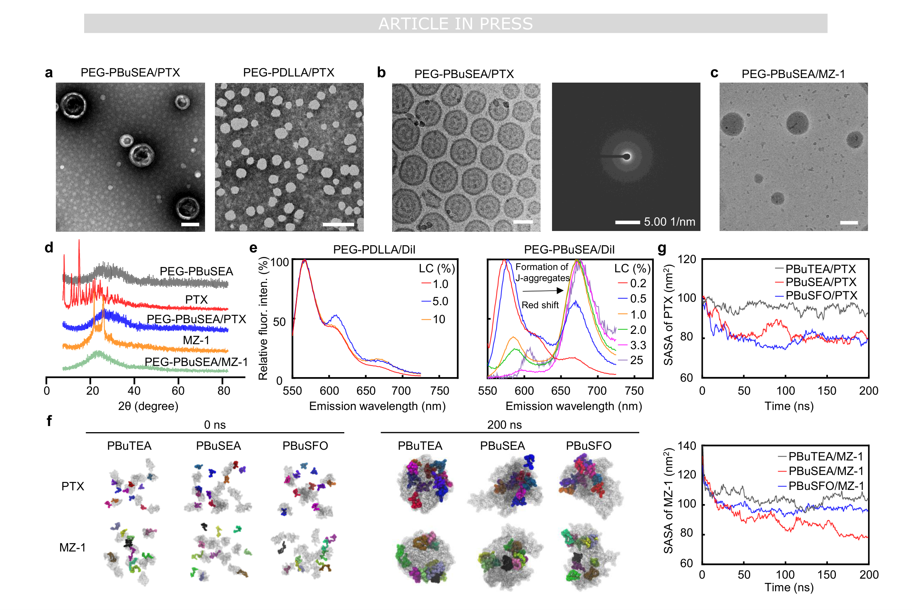
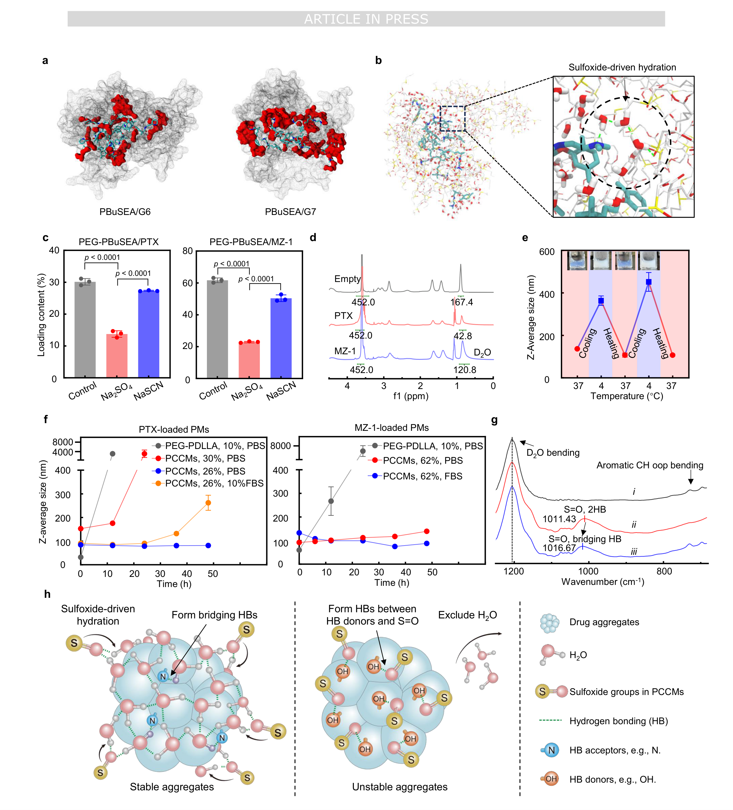

# 案例研究：桥连氢键稳定的 PCCM 载药胶束

来源论文：

> Wang, J., Ying, J., Huang, J. *et al.* **Bridging hydrogen-bond-stabilized polymeric coacervate core micelles for high-efficiency drug encapsulation and delivery.** *Nature Communications* (2026). DOI: [10.1038/s41467-026-72978-5](https://doi.org/10.1038/s41467-026-72978-5)

本案例总结这篇论文的阅读逻辑，并解释八张主图。图片均为原文未修改整页图版。

---

## 1. 一句话总结

作者构建了 PEG-PBuSEA 聚合物凝聚体核胶束，简称 PCCM。其水化、富亚砜的液态核通过桥连氢键稳定无定形药物纳米聚集体，从而实现广谱、高效载药和更好的体内递送。

---

## 2. 问题与瓶颈

很多药物水溶性差。传统聚合物胶束试图把药放进疏水核，但这经常失败，原因是：

- 疏水核致密且极性低；
- 很多药物结构差异大，与同一疏水核兼容性差；
- 药物容易结晶或形成大颗粒沉淀；
- 载药量常低于 10%；
- 制备通常依赖有机溶剂、蒸发或透析；
- 胶束在储存、冻干或血液稀释时容易聚集。

因此，真正的瓶颈不是“再加更多疏水聚合物”，而是设计一个兼容多种药物、又能保持纳米尺度稳定的核。

---

## 3. 目标材料状态

作者不是简单地要求药物分子级溶解，而是稳定另一种状态：

```text
无定形药物纳米聚集体
+ 水化富亚砜界面
+ PEG 稳定纳米粒子外壳
```

这一点很重要。聚集体并非一定有害；只要其表面被水化并被阻止继续生长，就可能成为有用的功能状态。

---

## 4. 核心化学洞察

关键官能团是亚砜：

```text
S=O
```

它类似一个聚合物化的 DMSO 溶剂化基元：

- 极性高；
- 是强氢键受体；
- 能结合水；
- 能与药物表面基团形成水桥氢键；
- 能让药物聚集体保持水化和无定形。

核心机制可以简化为：

```text
聚合物 S=O
  ↔ 水
  ↔ 药物聚集体表面，尤其是含 N 受体
```

---

## 5. 逐图解读

## Fig. 1 — PCCM 总体概念


### 目的

这张图介绍整个研究概念。

### 关键信息

PBuSEA 在超过 LCST 后形成液态凝聚体液滴。PEG 化把液滴转化为稳定纳米 PCCM。载药可通过简单的 Mix-and-Go 方法完成。

### 为什么重要

它展示了概念转变：

```text
普通疏水胶束核
  → 液态凝聚体核
```

### 逻辑作用

这是全文论点图。它在详细证据之前，先说明目标材料状态和机制。

---

## Fig. 2 — PBuSEA 形成液态凝聚体


### 目的

这张图证明 PBuSEA 不只是水溶性聚合物，而是会发生 LCST 型液-液相分离。

### 关键观察

- PBuSEA 在低温溶解。
- 升温后溶液变浑浊。
- 显微镜显示液滴。
- 盐离子移动云点。
- FRAP 显示液滴内部荧光恢复。
- 液滴融合，支持液态行为。
- 荧光探针表明极性高、黏度低。
- MD 模拟显示松散形貌、强氢键和高溶剂可及表面积。
- 疏水探针分配进入液滴，亲水聚合物被排除。

### 结论

PBuSEA 形成水化、极性、液态凝聚体相。这为溶剂化疏水药物提供了物理基础。

---

## Fig. 3 — PEG-PBuSEA 形成 PCCM 且保留凝聚体样核


### 目的

这张图把体相凝聚体连接到可用的纳米胶束。

### 关键观察

- PEG-PBuSEA 在水中自组装。
- DLS 显示粒径约 28 nm 且分布均匀。
- TEM 证实纳米粒子形成。
- 胶束内探针寿命与 PBuSEA 凝聚体接近。
- NMR 显示胶束核仍然水化且可运动。
- 对照聚合物表现出更脱水、致密或固体的核。

### 结论

PEG 不只是制造普通胶束，而是在纳米尺度稳定凝聚体状态。因此材料被称为聚合物凝聚体核胶束。

---

## Fig. 4 — PCCM 实现高载药和简易制备


### 目的

这张图测试材料是否解决了实际瓶颈。

### 关键观察

- PEG-PBuSEA 对紫杉醇和 MZ-1 都有高载药量。
- 硫醚、砜和长侧链对照载药量显著下降。
- 载药 PCCM 的粒径分布比许多对照更均匀。
- PCCM 冻干复溶后仍稳定。
- 在 40 种药物中，PCCM 表现出广谱高载药。
- Mix-and-Go 能在约一分钟内溶剂化聚集药物。
- PEG-PDLLA 对照经常沉淀。

### 结论

富亚砜凝聚体核不只是物理有趣，还形成了实用的高载药平台。

---

## Fig. 5 — PCCM 稳定药物纳米聚集体



### 目的

这张图回答药物在核内是分子分散还是聚集。

### 关键观察

- TEM 显示 PCCM 内部结构特殊。
- cryo-TEM 显示水化核内存在药物聚集体。
- 电子衍射和 XRD 表明药物聚集体是无定形，不是结晶。
- DiI 在 PCCM 中出现聚集相关光谱位移。
- MD 模拟显示药物在 PBuSEA 内聚集成簇。

### 结论

PCCM 不是简单把每个药物分子都分散开。它稳定药物纳米聚集体，阻止其生长成晶体或沉淀。

这是全文的核心概念创新。

---

## Fig. 6 — 药物结构决定载药


### 目的

这张图解释为什么有些药载药更好。

### 关键观察

- 传统描述符如 LogP 和 tPSA 与载药量相关性差。
- Hansen 溶解度参数距离只有中等相关。
- QSPR 分析识别出与氮相关的描述符更重要。
- 含芳香氮杂环的药物载药量更高。
- Gemfibrozil 引入含 N 取代基后载药优于疏水取代衍生物。
- SN38 本身难包载，而含氮衍生物 irinotecan 高效载药。

### 结论

载药不能只用疏水性解释。表面氢键受体，尤其是含氮基团，能帮助药物进入亚砜-水氢键网络。

---

## Fig. 7 — 桥连氢键稳定聚集体



### 目的

这张图给出机制模型。

### 关键观察

- MD 显示亚砜、水和药物表面基团形成共享氢键桥。
- 降低水活度的硫酸钠会降低载药。
- 硫氰酸钠影响较小。
- NMR 显示紫杉醇比 MZ-1 造成更强的核脱水。
- 温度循环改变胶束尺寸，说明结构受水化控制。
- 加入客体后，亚砜红外振动峰发生位移。
- 最后的示意图区分稳定水化聚集体和不稳定脱水聚集体。

### 结论

机制是桥连氢键：

```text
聚合物 S=O ↔ 水 ↔ 药物表面受体
```

它让药物聚集体保持水化、无定形和纳米尺度。

---

## Fig. 8 — 体内递送和治疗性能


### 目的

这张图测试高载药是否能转化为生物学获益。

### 关键观察

- 在多个模型中，PEG-PBuSEA/PTX 的肿瘤抑制和生存期优于 Genexol-PM。
- PCCM 随时间向肿瘤递送更多紫杉醇。
- 高载药 PEG-PBuSEA/MZ-1 可支持比传统 PEG-PDLLA/MZ-1 更高的给药剂量。
- PCCM 可共同载药 DC661 和 V9302。
- 共载 PCCM 降低游离联合用药的严重毒性。
- 体重和组织学结果显示测试条件下耐受性改善。

### 结论

高载药不只是制剂参数。它支持更高剂量暴露、联合载药、降低游离药毒性和更强的抗肿瘤效果。

---

## 6. 创新点

1. **用液态凝聚体核替代致密疏水核。**
2. **把亚砜富集聚合物作为聚合物化溶剂化基元。**
3. **稳定药物纳米聚集体，而不是强行追求分子分散。**
4. **提出 S=O、水、药物受体之间的桥连氢键机制。**
5. **开发少溶剂或无溶剂的 Mix-and-Go 载药。**
6. **建立含 N 药物结构与高载药的结构-性质规则。**
7. **在多种化学结构不同的药物上验证平台性。**
8. **从材料设计推进到动物疗效。**

---

## 7. 核心矛盾与解决方式

### 传统观点

```text
疏水药应该放入疏水核。
聚集是不好的，应当避免。
```

### 困难

但疏水核往往无法兼容多种药物。兼容性差、载药低，而且聚集会导致沉淀。

### 作者的洞察

药物聚集体不一定有害；如果其表面保持水化且无法继续生长，它反而可以被利用。

### 设计解决方案

使用富亚砜液态核，通过水桥稳定无定形纳米聚集体。

### 结果

材料把原本的失败模式，聚集，转化成了载药机制。

---

## 8. 可迁移方法论

### 规则 1：先定义客体状态

不要只问“哪种聚合物足够疏水”，要先问：

```text
我想稳定客体的什么状态？
```

### 规则 2：使用动态相互作用

强共价结合可能固定客体，但会阻碍释放。动态氢键可以稳定而不永久锁死。

### 规则 3：稳定界面，而不只是体相

很多失败发生在界面：药物-水、药物-聚合物、粒子-血清，或聚集体-核界面。界面必须被显式设计。

### 规则 4：用对照隔离单一变量

论文中，侧链长度、氧化态、嵌段架构和对照药物共同隔离了亚砜化学的作用。

### 规则 5：把数据挖掘与因果实验结合

QSPR 提示氮相关描述符重要；衍生物合成进一步验证了因果性。

### 规则 6：把制剂指标连接到应用指标

高载药只有在提高稳定性、靶部位暴露、疗效、安全性或可制造性时才有意义。

---

## 9. 新材料开发模板

可按相同逻辑设计新材料：

```text
1. 定义失败模式。
2. 定义期望客体状态。
3. 确定所需微环境。
4. 选择官能团。
5. 选择骨架和架构。
6. 构建小型材料库。
7. 筛选相行为和微环境。
8. 筛选客体装载。
9. 表征机制。
10. 优化稳定性和加工性。
11. 测试应用。
12. 定义局限和安全风险。
```

对 PCCM 来说：

```text
失败模式：低载药和沉淀
客体状态：无定形纳米聚集体
微环境：水化、极性、液态
官能团：亚砜 S=O
架构：PEG-b-PBuSEA
稳定方式：PEG 壳 + 桥连氢键
应用：高载药递送
```

---

## 10. 局限性与开放问题

1. **最高载药不一定等于最稳定载药。** 紫杉醇在最高载药时可能不稳定，稍低载药反而更稳。
2. **结构-性质规则需要更广验证。** 含 N 取代基趋势很有说服力，但仍需在更大药物集上检验。
3. **机制依赖组合证据。** MD、FTIR、NMR、盐扰动和衍生物支持模型，但每个桥连氢键的定量群体仍难直接成像。
4. **长期降解和代谢仍需研究。** 短期安全有前景，但转化开发需要详细毒理学。
5. **制造变异需要系统研究。** Mix-and-Go 简单，但放大、无菌生产、批次一致性和冻干仍需优化。
6. **体内释放路径未完全解析。** 文章显示肿瘤积累和疗效，但细胞内释放、蛋白冠效应等仍值得深入。
7. **向小分子疏水药以外推广还不明确。** 亲水大分子被凝聚体样核排除，因此不能自动推广到蛋白质或核酸。
